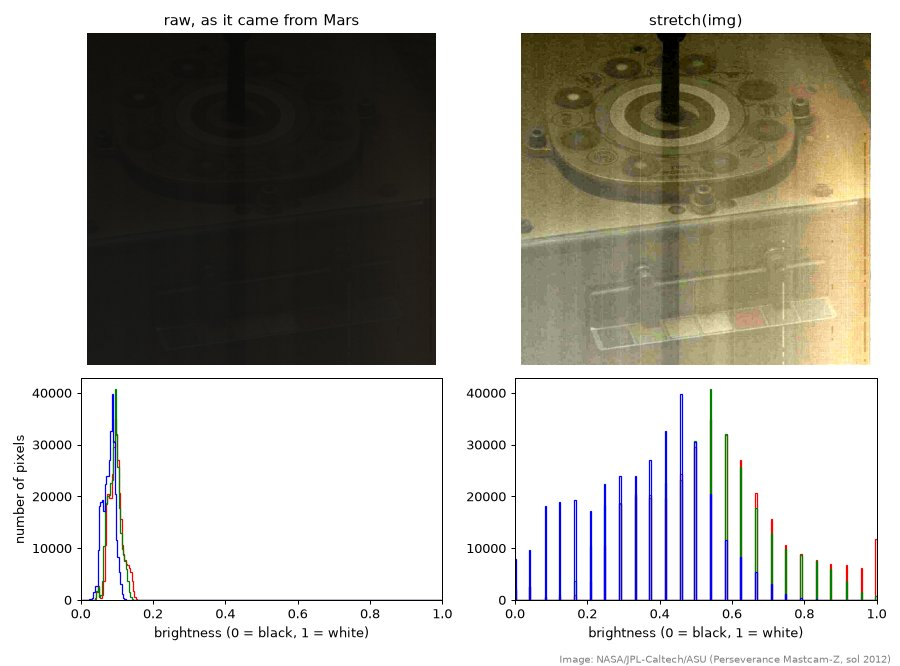
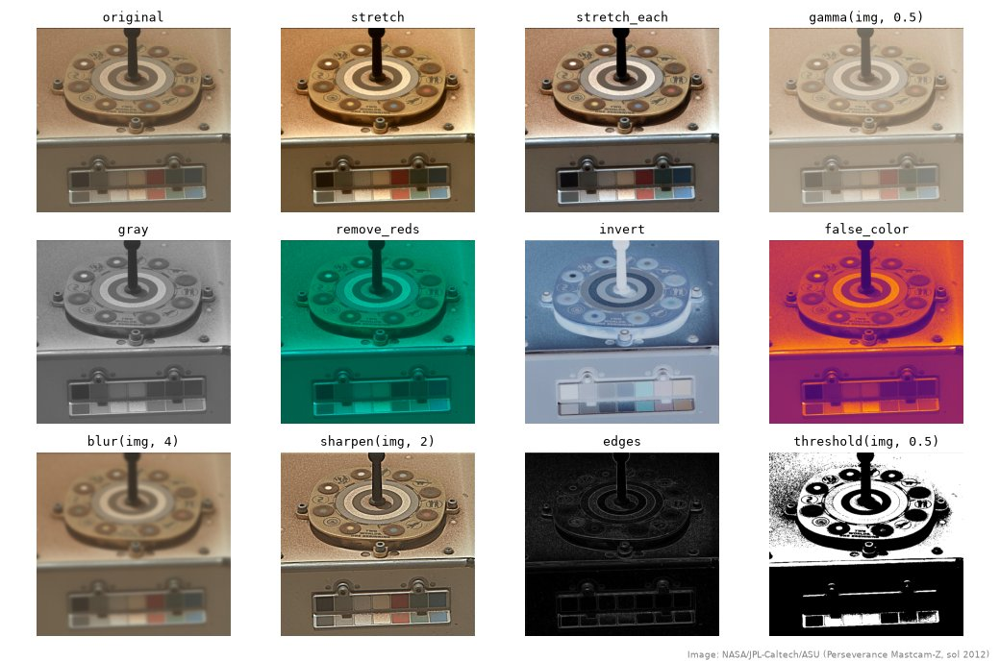

The Perseverance rover takes hundreds of pictures a day on Mars, and NASA posts every one of them online, *raw*: straight off the camera, before anyone has made them pretty. A lot of them look murky. Some look almost black.

Today we'll pick one and pull out the detail that's hiding in it. The trick is that a picture is just an array of numbers, so everything we've learned about arrays (math on a whole array at once, masks, slicing) turns into image processing. We'll build up the idea on tiny pictures first, then go get a real one from Mars, then work through a toolbox of techniques: contrast, color, blur, sharpen, edges. Along the way we'll find out what enhancement *can't* do, which turns out to matter as much as what it can.

## A picture is a grid of numbers

A grayscale image is a 2D array: rows and columns of numbers, one per pixel, where 0 is black and 255 is white. That's the whole secret.

Here's a tiny "image," six pixels tall and eight wide:

```{pyodide}
import numpy as np
import matplotlib.pyplot as plt

img = np.array([
    [ 20,  22,  19,  21,  20,  18,  22,  20],
    [ 21,  20,  23,  19,  22,  20,  21,  19],
    [ 19,  22, 200, 230, 210,  21,  20,  22],
    [ 20,  21, 220, 255, 225,  19,  22,  20],
    [ 22,  19, 205, 228, 199,  20,  21,  21],
    [ 20,  21,  19,  22,  20,  21,  19,  20],
])

print(img.shape)        # (rows, columns)
plt.imshow(img, cmap="gray", vmin=0, vmax=255)
plt.colorbar()
plt.show()
```

Try things: change one of the 20s to 255. Make a second bright spot. Make the whole thing dimmer with one line (`img = img / 2`... what does the picture do?).

Notice the axes: **row 0 is at the top**, and row numbers grow *downward*. That's upside down compared with every plot we've made so far. It's just a convention (it's how you read a page: top line first), but it'll trip us up at least once.

::: {.column-margin}
Why 255? Each pixel's brightness is stored in one byte, eight bits that are either 0 or 1. Thus, one byte can be used to represent the whole numbers from 0 to 255. That's 256 shades of gray, and I don't think our eyes can tell the difference between, e.g., gray 113 and 114... so 256 is more than enough!
:::

## Color is three grids

A color image stores *three* numbers per pixel: how much red, how much green, how much blue. So its shape is `(rows, columns, 3)`, and each of those three "layers" is called a **channel**. Here's a tiny one, two pixels tall and three wide:

```{pyodide}
tiny = np.array([
    [[255,   0,   0], [  0, 255,   0], [  0,   0, 255]],
    [[255, 255,   0], [255, 255, 255], [ 60,  60,  60]],
])
print(tiny.shape)

plt.imshow(tiny)
plt.show()

print("red channel:")
print(tiny[:, :, 0])        # every row, every column, channel 0
```

Top row: pure red, pure green, pure blue. Bottom row: red + green light makes... yellow (this is *light*, not paint, so the mixing rules are different from art class). All three at full is white, and equal amounts of all three is gray.

Try: change the gray pixel to `[200, 100, 0]`. What color do you predict? Then pull out the green channel and the blue channel the same way we pulled out red.

That last observation is worth holding on to: **if the red, green, and blue channels are identical, the "color" image is really a gray image.** Keep an eye out for that on Mars.

## Go get a picture from Mars

Browse the rover's raw images here: <https://mars.nasa.gov/mars2020/multimedia/raw-images/>

Scroll through a few hundred. (This is a task where your eyes are much faster than any code.) Some tips:

- Filter by camera. **Mastcam-Z** (the rover's main "eyes," up on the mast) is where most of the color pictures come from. Navcam and the Hazcams are mostly black and white.
- The *boring-looking* ones are the best candidates: murky, dark, washed out, low contrast. There's more hiding in them.
- Find one with a little white-and-gray target with colored squares on it if you can. That's the **calibration target**, and it will come in handy later.

When you find one you like, click it, then right-click the big image and choose **Copy Image Address** (on an iPad: press and hold, then **Copy**). You'll get a long web address ending in `.jpg` or `.png`. The version ending in `_1200.jpg` is plenty big.

Now in Colab, paste the toolbox below into the first cell and run it (it doesn't *do* anything yet, it just defines functions), then load your picture:

```python
url = "https://mars.nasa.gov/mars2020-raw-images/pub/ods/surface/sol/..."   # paste yours
img = load(url)

print(img.shape)
show([img], ["raw"])
```

Check the shape: (rows, columns, 3)? Then check whether it's actually color:

```python
print(np.array_equal(img[:, :, 0], img[:, :, 1]))     # is red exactly equal to green?
```

`True` means you've found a gray image in disguise: three identical channels. Plenty of the raw images are like that. Color tools won't do much to it, so you may want to go back and pick a different one... or not, if you're more interested in contrast than color.

## The toolbox

Here's our library of image tools. **Copy the whole thing into the first cell of your notebook.** Every one of them takes an image and gives back an image, so you can chain them: `sharpen(stretch(img))`.

You don't need to understand every line before using them, but read the docstrings, and by the end of class you should be able to say in words what each one does to the numbers.

```python
import numpy as np
import matplotlib.pyplot as plt
import imageio.v3 as iio
from scipy import ndimage

# ---------- getting images in and out ----------

def load(url):
    """Load an image from a web address. Returns floats from 0 to 1, shape (rows, cols, 3)."""
    img = iio.imread(url)
    if img.ndim == 2:                          # a gray image: copy it into three channels
        img = np.stack([img, img, img], axis=2)
    return img[:, :, :3] / 255                 # keep red, green, blue; scale 0-255 down to 0-1

def show(images, titles):
    """Show a list of images side by side, with a title over each."""
    fig, axes = plt.subplots(1, len(images), figsize=(5 * len(images), 4.5))
    for ax, im, title in zip(np.atleast_1d(axes), images, titles):
        ax.imshow(np.clip(im, 0, 1))
        ax.set_title(title)
        ax.axis("off")
    plt.show()

def histogram(img):
    """Plot how many pixels have each brightness, one line per channel."""
    for c, color in enumerate(["red", "green", "blue"]):
        plt.hist(img[:, :, c].ravel(), bins=256, range=(0, 1), color=color, histtype="step")
    plt.xlabel("brightness (0 = black, 1 = white)")
    plt.ylabel("number of pixels")
    plt.show()

# ---------- brightness and contrast: each pixel on its own ----------

def stretch(img, lo_pct=1, hi_pct=99):
    """Linear contrast stretch: the lo_pct percentile becomes black, hi_pct becomes white."""
    lo, hi = np.percentile(img, [lo_pct, hi_pct])
    return np.clip((img - lo) / (hi - lo), 0, 1)

def stretch_each(img, lo_pct=1, hi_pct=99):
    """Stretch red, green, and blue separately. Removes a color cast (is that honest?)."""
    out = np.zeros_like(img)
    for c in range(3):
        out[:, :, c] = stretch(img[:, :, c], lo_pct, hi_pct)
    return out

def gamma(img, g):
    """Bend the brightness curve: g < 1 lifts the shadows, g > 1 deepens them."""
    return img ** g

def invert(img):
    """Photographic negative."""
    return 1 - img

# ---------- color ----------

def gray(img):
    """Grayscale, weighted the way human eyes weight colors (we're most sensitive to green)."""
    g = 0.299 * img[:, :, 0] + 0.587 * img[:, :, 1] + 0.114 * img[:, :, 2]
    return np.stack([g, g, g], axis=2)

def scale_channels(img, r=1.0, g=1.0, b=1.0):
    """Multiply each channel by its own factor."""
    return np.clip(img * np.array([r, g, b]), 0, 1)

def remove_reds(img):
    """Turn the red channel off entirely."""
    return scale_channels(img, r=0)

def white_balance(img, top, bottom, left, right):
    """Scale the channels so the patch img[top:bottom, left:right] comes out neutral gray."""
    patch = img[top:bottom, left:right]
    means = patch.reshape(-1, 3).mean(axis=0)          # average red, green, blue in the patch
    return np.clip(img * means.mean() / means, 0, 1)

def false_color(img, cmap="inferno"):
    """Map brightness onto a color scale. The colors mean 'brighter', not 'what it looked like'."""
    return plt.get_cmap(cmap)(gray(img)[:, :, 0])[:, :, :3]

# ---------- neighborhoods: each pixel compared with the pixels around it ----------

def blur(img, size=3):
    """Replace each pixel with a weighted average of its neighbors, out to about `size` pixels."""
    return ndimage.gaussian_filter(img, sigma=(size, size, 0))

def sharpen(img, amount=1.0, size=3):
    """Unsharp mask: find the detail (image minus its blur) and add extra of it back."""
    detail = img - blur(img, size)
    return np.clip(img + amount * detail, 0, 1)

def edges(img):
    """Brightness change between neighboring pixels: bright where the picture has an edge."""
    g = gray(img)[:, :, 0]
    dx = np.zeros_like(g)
    dy = np.zeros_like(g)
    dx[:, 1:] = np.diff(g, axis=1)                     # change from each pixel to the one on its right
    dy[1:, :] = np.diff(g, axis=0)                     # ...and to the one below it
    e = np.sqrt(dx**2 + dy**2)                         # Pythagoras: total change
    e = e / e.max()
    return np.stack([e, e, e], axis=2)

def threshold(img, level=0.5):
    """Pure black and white: white wherever the brightness is above `level`."""
    m = (gray(img)[:, :, 0] > level).astype(float)
    return np.stack([m, m, m], axis=2)

# ---------- geometry ----------

def crop(img, top, bottom, left, right):
    """Keep only rows top..bottom and columns left..right."""
    return img[top:bottom, left:right]
```

One design decision in there deserves a mention. `load` divides by 255, so inside the toolbox every brightness is a decimal from 0 (black) to 1 (white) instead of a whole number from 0 to 255. That makes the algebra cleaner (1 means "full," and `1 - img` is a negative), and it dodges a nasty trap, described in the margin.

::: {.column-margin}
The trap: images normally store brightness as whole numbers 0 to 255, and *only* those. Ask NumPy for 10 − 20 in that format and you don't get −10. It wraps around to 246, nearly white. A "negative brightness" showing up as bright white is a great example of an answer that should make us suspicious. Working in decimals avoids it entirely.
:::

## Reading a histogram

Before we change anything, let's look at what we've got. A **histogram** counts how many pixels have each brightness:

```python
histogram(img)
```

The horizontal axis is brightness, from black on the left to white on the right. The height is how many pixels have that brightness. A dark, murky picture has all its pixels crammed into a narrow lump near the left. A well-exposed picture spreads across most of the range.

What does yours look like? Where's the lump? Is there anything at all out near 1?

## Stretching

Here's a real example from sol 2012 (October 2026): a Mastcam-Z picture of the calibration target, taken with almost no light. Its histogram is the lump on the bottom left. Every pixel is between about 0.04 and 0.14. Nothing is even remotely bright.

{fig-alt="Top left: a nearly black raw rover image. Top right: the same image after a contrast stretch, showing the calibration target with its rings, bolts, and color chips. Bottom left: the raw histogram, a narrow spike near zero. Bottom right: the stretched histogram, spread across the whole range but made of separated spikes, like a comb."}

The fix is to *stretch*: take the darkest pixels we care about and make them black, take the brightest and make them white, and spread everything in between evenly. That's a straight line:

$$\text{new} = \frac{\text{old} - \text{lo}}{\text{hi} - \text{lo}}$$

Check the ends: a pixel at exactly `lo` becomes $0/(\text{hi}-\text{lo}) = 0$, black. A pixel at `hi` becomes 1, white. Halfway between becomes 0.5. Anything darker than `lo` or brighter than `hi` would land below 0 or above 1, so `np.clip` pins those at 0 and 1.

How do we choose `lo` and `hi`? We could use the very darkest and brightest pixels, but one stray hot pixel would wreck that. Instead, `stretch` uses **percentiles**: by default, `lo` is a brightness that only 1% of pixels are darker than, and `hi` is one that only 1% are brighter than. We sacrifice the extreme 1% at each end (they become pure black or pure white) to make the other 98% use the whole range.

```python
s = stretch(img)
show([img, s], ["raw", "stretched"])
histogram(s)
```

In the example, the target comes out of the dark: rings, bolts, the little color chips along the bottom. That information was in the picture all along. It was just all squeezed into a sliver of the brightness range, too dark for us to tell apart.

Try `stretch(img, 5, 95)` and `stretch(img, 0, 100)`. What changes?

## The comb: what enhancement can't do

Now look closely at the stretched histogram in the example. It isn't a smooth hill. It's a **comb**: spikes with empty gaps between them.

Here's why. The raw image stored brightness as whole numbers from 0 to 255, and the middle 98% of its pixels used only the values 11 through 35. That's just **25 different shades.** Stretching spread those 25 shades out across the whole range... but it's still 25 shades. Nothing can land in the gaps between them, because there was never any pixel "between 23 and 24" to begin with.

This is the honest limit of image enhancement: **we can reveal what the camera recorded, but we can't create detail it didn't record.** Stretch hard enough and you start to see the evidence: blotchy patches, noise, faint stripes that were always there but too dark to notice. (Look at the stretched example closely. Those faint vertical streaks don't line up with anything on the calibration target, so my guess is they come from the camera itself. Either way, they were in the raw picture all along.)

CSI-style "enhance!" is fiction. Real enhancement is closer to turning up the volume on a quiet recording: you hear the words better, and you hear the hiss better too.

## Is an enhanced picture honest?

A question for your group, and it connects to something you saw this morning. Stretching a picture means choosing which range of brightness to spread across the screen. Where have we seen that before?

It's the same move as zooming in a plot's y-axis: `set_ylim` versus `stretch`. On Checkpoint 3, a zoomed-in axis made a 2% drop look like a collapse. A stretched Mars picture makes dim, low-contrast rocks look dramatic. Neither one changes a single number in the data. Both change what a reader *thinks* they're seeing.

So, when is an enhanced picture honest? Our answer from week 6 still works: when it says what was done to it. NASA labels these pictures "raw" precisely so that anyone processing them is on the hook for describing what they did.

And here's a harder one: **what color is Mars?** The raw pictures come out reddish-brown. `stretch_each` stretches each channel separately, which usually strips that cast away and leaves things looking grayer and "cleaner." Is that a better picture, or a less truthful one? (Mars really is red: the dust is full of iron oxide. Rust, basically.)

The rover team's actual answer involves the calibration target. Its gray squares are known to be gray, so if they come out tinted in a picture, the tint came from the lighting and the camera, not the target. `white_balance` does exactly this correction: give it the rows and columns of a patch you know should be gray (read them off the axes of `plt.imshow`), and it scales the three channels until that patch *is* gray.

```python
plt.imshow(img)       # find a gray square on the target; note its rows and columns
plt.show()

wb = white_balance(img, 850, 900, 420, 470)       # top, bottom, left, right: your numbers here
show([img, wb], ["raw", "white balanced"])
```

What does that do to the color of the ground? The target was sitting in Martian light, so "make the target gray" means "show the scene as if it were lit by Earth-like white light." Which version is the *real* color is... honestly a philosophical question, and it's one that planetary scientists argue about.

## The rest of the toolbox

Here's every tool applied to one picture of the calibration target. Click to enlarge.

{.lightbox fig-alt="A grid of twelve versions of the same Mars calibration target photo: original, stretch, stretch_each, gamma, gray, remove_reds, invert, false_color, blur, sharpen, edges, and threshold."}

The tools come in two families, and the difference is worth noticing.

**One pixel at a time.** `stretch`, `gamma`, `invert`, `gray`, `scale_channels`, `remove_reds`, `white_balance`, `false_color`, and `threshold` all compute each new pixel from *that same pixel* and nothing else. They're algebra applied to the whole array at once, exactly like week 4.

- `gamma(img, 0.5)` is $\text{new} = \text{old}^{0.5}$. Because brightness is between 0 and 1, a power less than 1 lifts dark values a lot and bright values only a little ($0.04^{0.5} = 0.2$, but $0.81^{0.5} = 0.9$). Good for digging into shadows without blowing out the highlights.
- `remove_reds` multiplies the red channel by zero. On Mars, that's a dramatic change (everything goes teal), which tells you how much of the scene's "color" lives in the red channel.
- `false_color` maps brightness onto a color scale, the way a thermal camera does. It can make subtle brightness differences easier to see, but the colors are *invented*: purple means "darker," not "purple."

**Neighborhoods.** `blur`, `sharpen`, and `edges` compute each new pixel from the pixel *and its neighbors*.

- `blur` replaces each pixel with an average of the pixels around it (nearby ones count more). Smooths out noise, and detail with it.
- `sharpen` is a clever trick. If `blur(img)` is the picture *without* its fine detail, then `img - blur(img)` is *just* the fine detail. Add extra of that back: $\text{sharpened} = \text{img} + \text{amount} \times \text{detail}$. Turn `amount` up to 5 and look closely: you'll see bright halos along edges, and the noise gets "sharpened" too. More sharpening stops meaning more detail at some point.
- `edges` asks how much each pixel differs from the pixel to its right and the pixel below it. Where the picture is smooth, neighbors are nearly equal, the differences are about zero, and the result is black. At an edge there's a big jump, and it lights up. The two differences get combined with Pythagoras, $\sqrt{dx^2 + dy^2}$, the same way we'd combine an east-west and a north-south distance. It's kind of amazing that one subtraction finds the outline of every rock.

::: {.column-margin}
Neighborhood operations are the doorway into a much bigger subject (filtering), which you'll meet again in later courses. We're just borrowing the three most useful ones.
:::

## Your turn

Pick your image and make the best version of it you can. "Best" is your call: maybe the most detail in the shadows, maybe the clearest rock texture, maybe the most striking picture. Chain at least three tools together, and try each one by itself first so you know what it's contributing.

Then write the caption like an engineer would, so a stranger could reproduce your picture exactly:

> Perseverance Mastcam-Z, sol 2012, image ZL0_2012_0845557723 (raw). Processing: `sharpen(stretch(img, 2, 98), amount=1.5)`. Contrast stretched, then sharpened; colors not corrected.

## Deliverable (2 EC)

One Colab notebook per group with:

1. Your raw image and your final version side by side, with the histograms of both.
2. The caption: which image (sol, camera, ID or web address) and exactly which tools, in order, with their settings.
3. Two or three sentences: what did your processing reveal, and what did it *not* or *could not* reveal? Is your final version an honest picture of Mars?

## Challenge: let the code browse

The website is great for browsing, but the same images are available as JSON, just like the ISS and the earthquakes in week 8. This asks for the 100 newest images, keeps only the color ones, and shows them as a contact sheet:

```python
import requests

url = "https://mars.nasa.gov/rss/api/?feed=raw_images&category=mars2020&feedtype=json&num=100&page=0&order=sol+desc"
reply = requests.get(url, timeout=30).json()

color = []
for item in reply["images"]:
    if item["camera"]["filter_name"].endswith("RGB"):
        color.append(item)
print(len(color), "color images out of", len(reply["images"]))

fig, axes = plt.subplots(4, 5, figsize=(15, 10))
for k, ax in enumerate(axes.ravel()):
    ax.axis("off")
    if k < len(color):
        ax.imshow(iio.imread(color[k]["image_files"]["small"]))
        ax.set_title(f'{k}: sol {color[k]["sol"]}', fontsize=9)
plt.show()
```

Print the whole reply once and look around first (that's the habit, right?). Then: are all the "color" ones actually color? (Check one with `np.array_equal`.) What do `page=1` and `num=` do to the web address? Can you find the path to an image's caption, or the time it was taken?

::: {.content-hidden}
**Instructor notes (planning only — stripped from the rendered site):**

**Timing (~55 min after the checkpoint).** Tiny gray + tiny color cells, 10 min. Browsing and loading, 10 min (this is fun and will expand to fill any time given; call time). Histogram + stretch + the comb, 10 min, with the comb as a whole-room moment on the projector. Honesty + color discussion, 5–10 min. Free play with the toolbox + deliverable, 15–20 min. The challenge is for groups who finish early.

**What I tested (Oct 18, 2026).** Every function in the toolbox, on real Perseverance images from sol 2012, in a fresh Python environment with the same packages Colab has (numpy, matplotlib, imageio, scipy). `load` straight from a copied image address works (`iio.imread(url)` handles web addresses). Every tool returns an array of the same shape with values in 0–1. The contact-sheet challenge runs in ~3 s: on Oct 18, 12 of the 100 newest images had a `filter_name` ending in `RGB`, and a few of those still looked gray, so the "are they really color?" question has a real answer.

**The example images (both sol 2012, Oct 18 UTC, NASA/JPL-Caltech/ASU).** Dark: `ZL0_2012_0845557723_582ECM_N0920000ZCAM03022_100085J01_1200.jpg`, channel means ~0.09, 1st/99th percentiles 11/255 and 35/255, so the stretch spreads exactly 25 levels (that's the comb). Gallery: `ZR0_2012_0845557833_582ECM_N0920000ZCAM03022_100085J01_1200.jpg`, the same target properly exposed, two minutes later with the other eye. Full addresses start `https://mars.nasa.gov/mars2020-raw-images/pub/ods/surface/sol/02012/ids/edr/browse/zcam/`. The figures were made at half resolution with the toolbox exactly as printed on this page.

**Surprises students will hit.**

- *Gray in disguise.* Navcam, Hazcam, SkyCam, and many Mastcam-Z frames are stored as three identical channels. Today's newest SkyCam image did this. `np.array_equal` exposes it.
- *Sun images.* Mastcam-Z frames with `ND` in the filter name (`ZCAM_L7_RGB_ND6`) are taken through a dark neutral-density filter to look at the sun. They're almost entirely black; stretching mostly reveals noise. A fine thing to discover, a bad choice for the deliverable.
- *White balance coordinates.* The `850, 900, 420, 470` in the example is a placeholder; students read their own patch off the `imshow` axes. Picking a white or gray square works; picking a colored one gives hilarious results.
- *Big images.* Full-resolution PNGs can be 5000+ pixels wide. `blur` and `sharpen` on those take several seconds. The `_1200.jpg` versions are fast.
- *Percentiles on a mostly-black image* (lots of sky shadow, or the sun images): `lo` and `hi` can be nearly equal, so the stretch divides by a tiny number and the picture becomes harsh noise. Moving the percentiles in (`stretch(img, 5, 95)`) or cropping first fixes it.

**Scope.** Blur, sharpen, and edges are neighborhood operations, deliberately included for completeness; the margin note points forward without going into filtering, kernels, or frequency. Gamma is a power function on numbers between 0 and 1, which is algebra.

**Grading.** Good-faith completion. The caption is the A3 seed (provenance: "could a stranger reproduce this?"), and question 3 is the A2 seed. A caption that names the tools but not their settings is a good conversation, not a penalty.
:::
